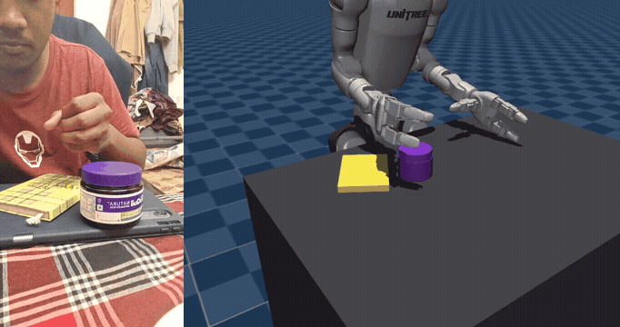
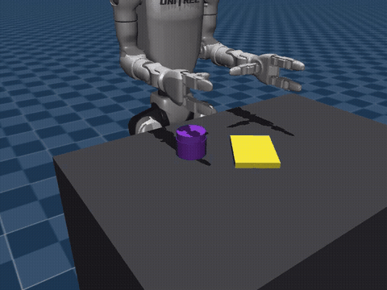

# 🤖 palm2policy: Teaching a Humanoid From Phone Videos of My Hand

[](https://opensource.org/licenses/MIT)
[](https://www.python.org/downloads/)
[](https://pytorch.org/)
[](https://mujoco.org/)

> I filmed my own hand with a phone, picking up a tub and putting it on a notebook. This repo turns those clips into 3D demonstrations, replays them on a Unitree G1 humanoid with Dex3 hands in MuJoCo, multiplies them with physics-checked augmentation, and trains an ACT / ACT-JEPA policy. The policy then does the task by itself on layouts it has never seen.

<p align="center">
  <br>
  <em>Left: my demonstration, filmed on a phone. Right: the G1 replaying that same demonstration in MuJoCo after hand/tub tracking and retargeting (the carry is played 1.5× slower).</em>
</p>
<p align="center">
  <br>
  <em>The trained ACT policy running closed-loop on an unseen layout. Nothing is scripted or replayed: the network picks every joint target from the current state.</em>
</p>

| Headline (300 unseen layouts, 95% CI) | Success |
|---|---|
| Policy trained on my 17 raw demos only | **5%** (3–8) |
| Policy trained on my demos + augmentation (587 episodes) | **81–82%** (76–86) |

---

## 📖 Table of Contents
- [Overview](#-overview)
- [Key Features](#-key-features)
- [System Architecture](#️-system-architecture)
- [Repository Structure](#-repository-structure)
- [Installation](#-installation)
- [Dataset Preparation](#-dataset-preparation)
- [Usage Guide](#-usage-guide)
  - [1. Videos to demonstrations](#1-videos-to-demonstrations)
  - [2. Replay and augmentation](#2-replay-and-augmentation)
  - [3. Training (imitation learning)](#3-training-imitation-learning)
  - [4. Evaluation](#4-evaluation)
- [Configuration](#️-configuration)
- [Results & Benchmarks](#-results--benchmarks)
- [What Worked, What Didn't](#-what-worked-what-didnt)
- [Limitations](#️-limitations)
- [License](#-license)
- [Acknowledgements](#-acknowledgements)

---

## 📖 Overview

**The task:** pick up a purple tub with the right hand and place it upright on a notebook. The tub and the notebook start in different places every time.

**The pipeline:**
1. A phone records me doing the task.
2. MediaPipe finds my hand, and colour tracking finds the tub.
3. Both are converted to metric 3D paths on the table.
4. The G1 humanoid replays each path in MuJoCo with full physics.
5. Augmentation generates hundreds of new layouts, keeping only those where the robot really succeeded.
6. An Action Chunking Transformer (ACT) learns to do the task from that data.

**What this project is not:** there is no VLA model, no language input and no RL fine-tuning. The policy is a ~7M-parameter transformer trained from scratch by imitation, using state observations rather than images. I chose a simple task on purpose. With a phone, no markers and two days, I wanted every step from video to policy to work and to be checkable.

An episode counts as a **success** if, 0.5 s after release:
- the tub's centre is inside the notebook's footprint,
- the tub rests on the notebook (height within 1 cm),
- it is upright (tilted less than 20°).

---

## ✨ Key Features

* **Markerless capture with one phone.** The tub lid's known diameter (7.42 cm) gives metric scale and depth in every frame. There's no calibration board, no ArUco markers and no depth camera.
* **Occlusion-aware tracking.** While my hand is hidden around the tub, the tub's own path stands in for the carry. The hand is followed by its position, not by MediaPipe's flickering left/right label.
* **Physics-based retargeting.** IK ([mink](https://github.com/kevinzakka/mink)) maps my wrist to the G1 arm and waist, and my finger bend to Dex3's three fingers. The tub is a free physical object, so a bad grasp really drops it.
* **MimicGen-style augmentation.** My motions are re-targeted to random layouts, and every episode is verified in simulation before it is kept.
* **Two policies, one codebase.** ACT and ACT-JEPA share all code except the extra JEPA objective.
* **Honest evaluation.** The same 300 unseen layouts are used for every policy, with Wilson 95% confidence intervals, a second training seed, and a no-human-data baseline.

---

## 🏗️ System Architecture

```
phone video ──► hand landmarks (MediaPipe) ─┐
            └─► tub lid tracking (colour) ──┴─► metric demo (cm, table frame)
                                                         │
                                                         ▼
                              replay on G1 + Dex3 in MuJoCo (IK + physics)
                                                         │
                                                         ▼
                     augmentation: random layouts, keep only physics successes
                                                         │
                                                         ▼
                            ACT / ACT-JEPA policy  ──►  closed-loop evaluation
```

1. **Perception** (`extract_hand.py`, `track_tub.py`, `make_demos.py`). A pinhole camera model turns pixels into centimetres. The focal length comes from the phone's 78° field of view (f ≈ 988 px at 720×1280), and depth comes from the lid's apparent size. The camera's tilt (~13°) is estimated from where the tub rests. Hand depth is anchored to the tub's depth at the grasp. Pick and place are detected from the tub's speed.
2. **Retargeting** (`sim/replay.py`). The table frame is rotated into the robot's frame.
   - **Wrist:** the approach follows my palm relative to the grasp point, and the carry follows the tub's measured path.
   - **Fingers:** index → index, middle/ring/pinky → middle, thumb → thumb.
   - **Joints:** they come from differential IK and are executed by position actuators with gravity compensation.
3. **Augmentation** (`sim/augment.py`). For each demo and random layout, the tub start is moved and the carry rotated. The motion is re-solved with IK and simulated, and the episode is kept only if it succeeds.
4. **Policy** (`train_act.py`). [ACT](https://arxiv.org/abs/2304.13705) predicts the next 20 joint targets (0.67 s) from the current state. It uses the plain autoencoder variant, as in the ACT-JEPA paper's baseline, with one encoder token per kind of sensing.
   - **Observation (31 numbers):** 17 joint angles (right arm 7, waist 3, right hand 7), tub position and up-axis, notebook position and direction, and 4 touch flags.
   - **Action (17 numbers):** joint targets.
   - **[ACT-JEPA](https://arxiv.org/abs/2501.14622)** adds a predictor that must guess the representation of the *next* 20 observations, with targets from an EMA copy of the encoder. It runs exactly like ACT at test time.
5. **Evaluation** (`sim/eval_policy.py`). The policy runs closed-loop with ACT's temporal ensembling, on layouts drawn with a seed never used in training.

---

## 📁 Repository Structure

```text
├── extract_hand.py          # phone video -> hand landmarks (MediaPipe)
├── track_tub.py             # phone video -> tub lid track, pick/place frames
├── make_demos.py            # landmarks + tub track -> metric demos in the table frame
├── sim/
│   ├── scene.py             # G1 + Dex3, table, tub, notebook (MuJoCo)
│   ├── replay.py            # retarget one demo and replay it with physics
│   ├── replay_all.py        # replay every demo, report success
│   ├── augment.py           # random layouts -> physics-checked episodes (+ scripted baseline)
│   └── eval_policy.py       # closed-loop evaluation on unseen layouts
├── train_act.py             # ACT and ACT-JEPA
├── probe.py                 # world-model probe (frozen encoder -> future joints)
├── run_all.sh               # main experiments
├── run_extra.sh             # second seeds + 300-layout evaluation
├── summarize.py             # collects every result into results.md
├── data/samples/            # sample clips, tracking outputs and demos
├── assets/                  # GIFs for this README
├── requirements.txt         # Python dependencies
└── README.md                # this file
```

---

## 💻 Installation

Tested on Ubuntu with Python 3.12 and an RTX 3050 laptop GPU (4 GB).

**1. Clone the repository:**
```bash
git clone https://github.com/<your-username>/palm2policy.git
cd palm2policy
```

**2. Set up a conda environment:**
```bash
conda create -n palm python=3.12 -y
conda activate palm
```

**3. Install dependencies:**
```bash
pip install --upgrade pip
pip install -r requirements.txt
```

**4. Get the robot model** (Unitree G1 with Dex3 hands, from MuJoCo Menagerie):
```bash
git clone --depth 1 https://github.com/google-deepmind/mujoco_menagerie third_party/mujoco_menagerie
```
`sim/scene.py` looks for `third_party/mujoco_menagerie/unitree_g1/scene_with_hands.xml`. Set the `G1_SCENE` environment variable to use another path.

The MediaPipe hand model (`hand_landmarker.task`) is downloaded automatically into the output folder the first time `extract_hand.py` runs.

---

## 📊 Dataset Preparation

**How the data was collected**

* **Camera:** Poco F6, 720×1280 portrait video at 30 fps. The phone stood across the table, facing me and tilted down about 13°. There were no markers, gloves or calibration board.
* **Hand:** right hand only.
* **Purple tub:** body ⌀ 7.86 cm (circumference 24.7 cm), height 4.6 cm. The lid is ⌀ 7.42 cm (circumference 23.3 cm) and 1.8 cm high.
* **White tub:** circumference 24.6 cm, height 8.8 cm (recorded, but not used).
* **Notebook:** 15.3 × 10.8 cm. Its thickness (1.5 cm) is assumed, not measured.
* **Recordings:** 25 clips with the purple tub and 22 with the white tub, each one pick-and-place of about 6–9 s. Between clips I changed the tub's start position and the notebook's position and angle.
* **Used:** 22 of the 25 purple clips. One failed lid tracking, and two gave implausible paths.

**What is in this repo.** `data/samples/` holds a representative sample:
- a few raw clips
- their hand-tracking and tub-tracking outputs
- the metric demos (`demos/*.npz`, `summary.csv`, `overview.png`)

The augmented datasets (several GB) are not committed. Regenerate them with the commands below.

**Layout expected by the scripts:**
```text
data/purple/*.mp4        # your raw clips
hand_out/                # output of extract_hand.py
tub_out/                 # output of track_tub.py
demos/                   # output of make_demos.py
data/aug_<seed>/         # output of sim/augment.py
runs/<name>/             # trained policies and evaluations
```

---

## 🚀 Usage Guide

### 1. Videos to demonstrations
```bash
python extract_hand.py data/purple hand_out --hand right --overlay   # --overlay writes check videos
python track_tub.py    data/purple tub_out --overlay
python make_demos.py   hand_out tub_out demos                         # demos/*.npz + overview.png
```

### 2. Replay and augmentation
```bash
python sim/replay.py demos/VID_20261102_004944.npz --video replay.mp4   # one demo, with video
python sim/replay_all.py demos                                          # all demos -> success count

for s in 1 2 3 4; do python sim/augment.py demos data/aug_$s --per-demo 15 --seed $s; done
python sim/augment.py demos data/raw --raw                                  # baseline: my demos only
python sim/augment.py demos data/scripted_1 --per-demo 15 --seed 1 --scripted   # baseline: no human motion
```

### 3. Training (imitation learning)
```bash
python train_act.py data/aug_1 data/aug_2 data/aug_3 data/aug_4 --out runs/act_aug
python train_act.py data/aug_1 data/aug_2 data/aug_3 data/aug_4 --out runs/jepa_aug --jepa
```

### 4. Evaluation
```bash
python sim/eval_policy.py runs/act_aug/policy.pt --episodes 300 --seed 777 \
       --out runs/act_aug/eval300 --videos 3          # writes eval.json + policy_ep*.mp4
python probe.py runs/act_aug/policy.pt data/aug_1 data/aug_2 data/aug_3 data/aug_4
```

**Reproduce every table below:**
```bash
bash run_all.sh   2>&1 | tee logs/run_all.log
bash run_extra.sh 2>&1 | tee logs/run_extra.log      # ends by writing results.md
```

Rough timings on the RTX 3050: ACT on 587 episodes takes about 30 min, and on 1817 episodes about 1.6 h. ACT-JEPA takes 2.5–3× as long as ACT.

---

## ⚙️ Configuration

There are no config files. The few settings that matter are constants at the top of each script:

| Setting | Value | Where |
|---|---|---|
| Focal length (pixels) | `F_PX = 988` | `make_demos.py` |
| Lid diameter | `LID_D = 0.0742` m | `make_demos.py` |
| Notebook thickness (assumed) | `NOTEBOOK_H = 0.015` m | `make_demos.py`, `sim/scene.py` |
| Grasp offset in the hand | `G = [0.11, 0.040, 0.0]` m | `sim/replay.py` |
| Grip height above tub centre | `GRASP_DZ = 0.025` m | `sim/replay.py` |
| Carry slow-down | `CARRY_SLOW = 1.5` | `sim/replay.py` |
| Tub start region (augmentation) | x 0.28–0.42 m, y −0.20 to −0.04 m | `sim/augment.py` |
| Action chunk | `CHUNK = 20` steps (0.67 s) | `train_act.py` |
| Training | 30 epochs, batch 256, lr 1e-4 (cosine), AdamW | `train_act.py` flags |
| ACT-JEPA EMA | `--ema 0.996` | `train_act.py` |
| Episode length at test | `MAX_STEPS = 330` (11 s at 30 Hz) | `sim/eval_policy.py` |

---

## 📈 Results & Benchmarks

Every number is the success rate on **300 layouts never seen in training**, the same 300 for every policy. The brackets are 95% Wilson confidence intervals. At n = 300, two numbers within about ±5 points of each other cannot be told apart.

### 1. Does augmentation matter? Yes, by far.

| Policy | Training data | Episodes | Success |
|---|---|---|---|
| ACT | my demos only, original layout | 17 | **5%** (3–8) |
| ACT | my demos + augmentation | 587 | **81%** (76–85) |
| ACT (2nd seed) | my demos + augmentation | 587 | **82%** (78–86) |

### 2. Does my human data beat a scripted demonstrator? No, it's a tie.

The baseline uses **no human motion**: a hand-written planner with a straight approach from above, fixed timing, a straight 4.5 cm-high carry, and a fully open or closed hand. It goes through the same augmentation, training and evaluation.

| Policy | Training data | Episodes | Success |
|---|---|---|---|
| ACT | scripted, no human motion | 1107 | 79% (74–83) |
| ACT | scripted, no human motion (about my size) | 553 | 80% (75–84) |
| ACT | **my demos** + augmentation | 587 | 81% (76–85) |
| ACT (2nd seed) | **my demos** + augmentation | 587 | 82% (78–86) |

I expected human demos to win, and they don't measurably. My reading is that the phone video replaced a hand-tuned planner at no cost, but this task is easy enough for a straight-line script to solve. A task where *how* you move matters (obstacles, awkward grasps, tight placements) is where human motion should pull ahead. I haven't tested that.

Two caveats to be fair about:
- The scripted baseline still uses the notebook placements taken from my demos.
- My demos replay successfully about 44% of the time under augmentation, against about 83% for the script, so they needed more simulation tries per kept episode.

### 3. Does ACT-JEPA help? Not that I can measure.

| Policy | Episodes | Seed 1 | Seed 2 |
|---|---|---|---|
| ACT | 587 | 81% (76–85) | 82% (78–86) |
| ACT-JEPA | 587 | 82% (78–86) | 85% (81–89) |

**World-model probe** (from the ACT-JEPA paper): freeze the encoder, train a small decoder to predict the next 20 joint states, and measure the error on held-out episodes (lower is better).

| Policy | RMSE (rad) | ATE (rad) |
|---|---|---|
| ACT | 0.0651 | 0.1458 |
| ACT (2nd seed) | 0.0603 | 0.1492 |
| ACT-JEPA | 0.0653 | 0.1455 |
| ACT-JEPA (2nd seed) | 0.0568 | 0.1385 |

ACT-JEPA leans slightly better, but the seed-to-seed spread is as large as the gap between methods. In the data-scaling runs below, it's sometimes worse. My guess is that the paper's gains come from learning structure from **images**, while my observations are already clean low-dimensional state.

### 4. Does more data help? No, success plateaus early.

| Episodes | ACT | ACT-JEPA | Validation action L1 (ACT) |
|---|---|---|---|
| 280 | 83% (79–87) | 86% (81–89) | 0.070 |
| 587 | 81–82% | 82–85% | — |
| 1817 | 84% (79–87) | 81% (76–85) | 0.025 |

With 6.5× more data, the offline error drops by almost 3×, **but closed-loop success doesn't move**. Around 280 augmented episodes is already enough. The remaining ~17% of failures aren't caused by too little data: fitting the demonstrations more closely doesn't stop small errors from building up while the robot acts.

**How the policies fail:** about two thirds of failures are "not on notebook" (the tub lands slightly off the edge), and one third are "tipped over".

### Replay: do my raw demos transfer to the robot?

| Version | Demos replayed successfully |
|---|---|
| First attempt | 0 / 22 |
| Final | **17 / 22** |

These fixes made the difference:
- gravity compensation on the arm (it sagged below the IK targets)
- gripping 2.5 cm above the tub's middle so the lowest finger clears the table
- calibrating where the tub sits in the closed Dex3 hand
- playing the carry 1.5× slower, with an exact final placement height
- a short stand-off before the grasp, and dwell times for closing and opening the hand

---

## 🔍 What Worked, What Didn't

**Worked**
- **The lid as a ruler.** It gives metric scale and depth from one phone camera.
- **The tub's path for the carry.** The hand is hidden while holding the tub, but the tub isn't.
- **Tracking the hand by position.** Following it by position instead of by MediaPipe's left/right label removed most of the fake tracking gaps.
- **Physics-checked augmentation.** It was the single biggest effect (5% → ~82%).
- **300-layout evaluation with a second seed.** On 100 layouts, one ACT-JEPA run scored 86%, which looked like a real gain. With more layouts and another seed, it wasn't.

**Didn't work, or didn't help**
- **The white tub.** Its 22 clips are unused. The tub tracker is tuned to the purple lid's colour, and I didn't have time to build one for white.
- **Some purple clips.** 3 of 25 couldn't be used. On 8 of the remaining 24, fingers hid the lid too long, so the carry is a smooth fallback path between the measured pick and place points.
- **ACT-JEPA, more data and human vs. scripted motion** gave no measurable difference.

---

## ⚠️ Limitations

- **Simulation only.** Nothing here ran on a real robot.
- **State-based policy.** It is given the tub's and notebook's poses directly, not images. That makes the task much easier than vision-based control.
- **Fixed base.** The robot's base doesn't move; only the right arm, waist and right hand do.
- **Three fingers.** Dex3 has three fingers, so my five are compressed into three.
- **Fixed approach direction.** The wrist approaches at a fixed 60° for reachability, so this part of my motion isn't transferred.
- **Assumed constants.** The camera intrinsics come from the phone's spec sheet, not a calibration, and the notebook thickness is assumed.
- **Small scope.** One task, one object and one person.

---

## 📜 License

Code is distributed under the MIT License; see `LICENSE`. The G1 and Dex3 models in `third_party/` keep their own licenses from MuJoCo Menagerie.

---

## 🙏 Acknowledgements

* [MuJoCo](https://mujoco.org/) and [MuJoCo Menagerie](https://github.com/google-deepmind/mujoco_menagerie) for the physics and the Unitree G1 + Dex3 model.
* [mink](https://github.com/kevinzakka/mink) for differential inverse kinematics.
* [MediaPipe Hand Landmarker](https://ai.google.dev/edge/mediapipe/solutions/vision/hand_landmarker) for hand tracking.
* [ACT](https://arxiv.org/abs/2304.13705) (Zhao et al.) and [ACT-JEPA](https://arxiv.org/abs/2501.14622) (Vujinovic & Kovacevic) for the policy architectures.
* [MimicGen](https://arxiv.org/abs/2310.17596) for the augmentation idea.
* Built for the Awign × Armature AI Labs Humanoid Challenge.
